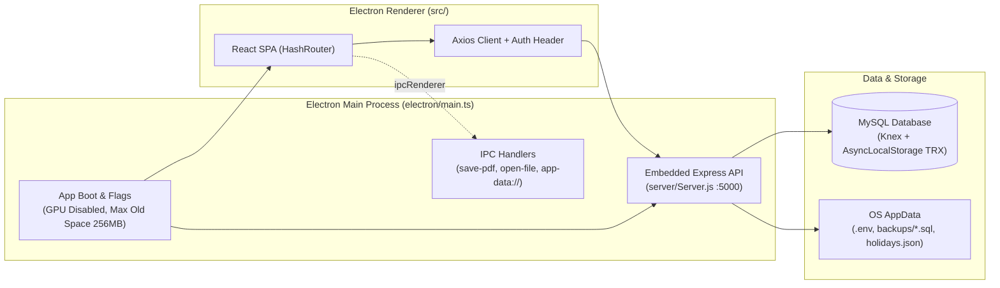
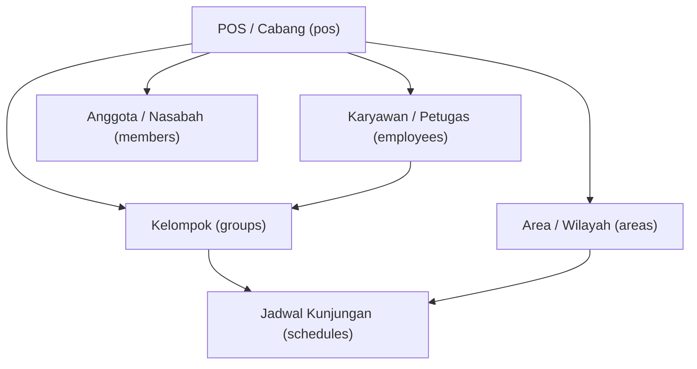
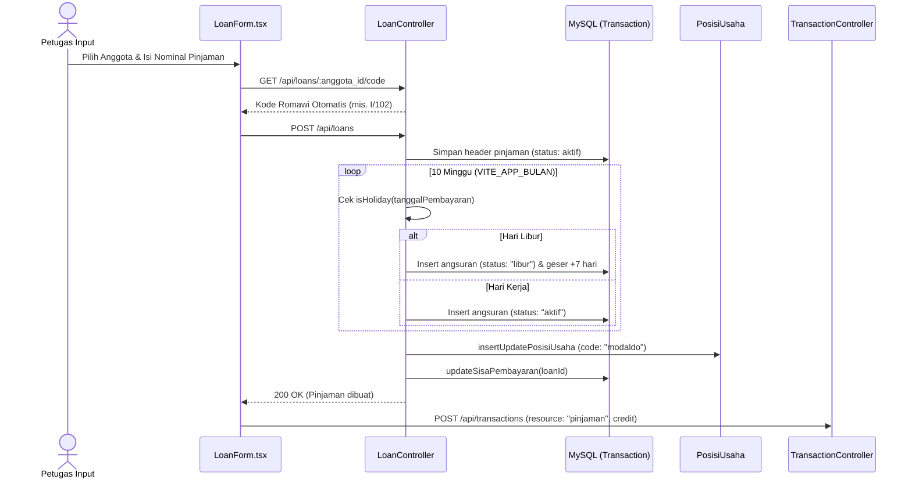
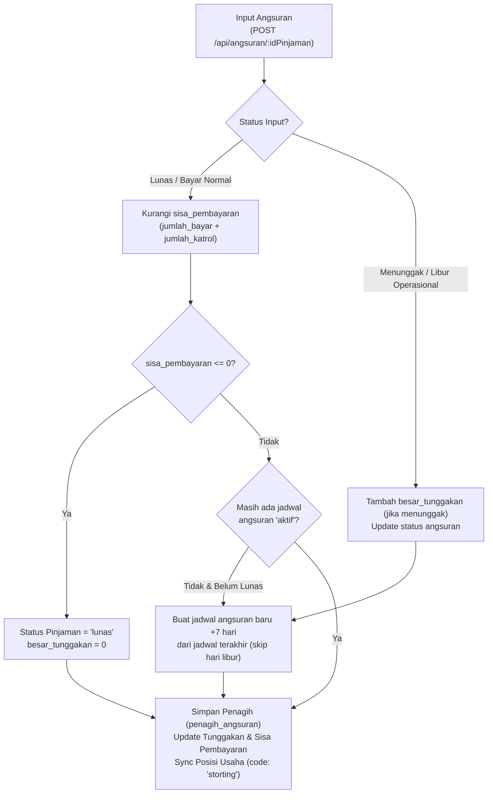

# Technical Specification — Koperasi Desktop (Koperasi Saferine Jaya Mandiri)

## 1. Gambaran Umum & Tech Stack

Aplikasi manajemen operasional koperasi berbasis desktop (offline-first / local network DB) untuk mengelola master wilayah/kelompok, anggota, pinjaman mingguan, angsuran, kas/transaksi, laporan laba-rugi, posisi usaha, dan audit log.

- **Desktop Runtime**: Electron (`electron/main.ts`)
- **Frontend**: React 19 + TypeScript + Vite + Tailwind CSS + React Router (`HashRouter`)
- **Backend (Embedded)**: Express.js (`server/Server.js`) berjalan satu proses dengan Electron Main Process di port `5000` (atau `VITE_APP_PORT`)
- **Database**: MySQL (`mysql2` + Query Builder `knex`)
- **Autentikasi**: JWT (`jsonwebtoken`, masa aktif 7 hari) + `bcryptjs` + Header Secret Middleware (`verifySecret`)

---

## 2. Arsitektur Sistem & Alur Booting

### Urutan Startup (`electron/main.ts` & `server/config/db.js`)
1. **Optimasi Resource**: `app.disableHardwareAcceleration()`, `--max-old-space-size=256`, dan `backgroundThrottling: true`.
2. **Protokol Custom**: Mendaftarkan skema `app-data://` untuk mengakses file lokal di direktori `userData` OS.
3. **Konfigurasi `.env`**: `loadEnvConfig()` di `server/config/db.js` menyalin `.env` dari root/executable ke `AppData/.env` lalu memuat konfigurasi database.
4. **Koneksi Database & Transaksi**: Membuat singleton `knex` yang dibungkus `Proxy` dan `AsyncLocalStorage` (`transaction(callback)`), sehingga semua query model di dalam blok `transaction()` otomatis memakai transaksi DB yang sama.
5. **Start Server & UI**: `server/Server.js` listen di port `5000`, lalu `createWindow()` membuka `BrowserWindow` yang memuat Vite Dev Server atau `dist/index.html`.

---

## 3. Alur Autentikasi & Otorisasi Scope POS

1. **Login (`POST /api/login`)**:
   - `AuthController.login` memeriksa `username` di tabel `users` dan memvalidasi hash password via `bcrypt.compare`.
   - Mengembalikan objek `user` dan JWT `token` (berlaku 7 hari).
2. **Proteksi Endpoint (`/api/*`)**:
   - Semua route di bawah `/api` melewati middleware `verifySecret` dan `authenticate` (validasi Bearer JWT & injeksi `req.user`).
3. **Isolasi Data Berdasarkan Role & POS**:
   - Role **`pusat`** dan **`controller`**: Bebas melihat dan memfilter lintas cabang/POS (`pos_id`).
   - Role lain (petugas/admin cabang): Parameter `pos` / `pos_id` pada controller otomatis dikunci ke `req.user.pos_id`.

---

## 4. Alur Master Data & Hierarki Wilayah

| Modul | Controller | Model | Fungsi Utama |
| :--- | :--- | :--- | :--- |
| **POS** | `PosController.js` | `Pos.js` | CRUD unit pelayanan/cabang koperasi. |
| **Area** | `AreaController.js` | `Area.js` | CRUD area cakupan per POS. |
| **Kelompok** | `GroupController.js` | `Group.js` | CRUD kelompok anggota & penugasan petugas lapangan. |
| **Karyawan** | `EmployeController.js` | `Employe.js` | CRUD staf/penagih/mantri, generator NIP otomatis (`/employees/getNip`). |
| **Pengguna** | `UserController.js` | `User.js` | CRUD akun login aplikasi, role, dan penempatan POS. |
| **Anggota** | `MemberController.js` | `Member.js` | CRUD nasabah, validasi duplikat NIK (`/nik-check`) & No KK (`/nokk-check`), nomor urut (`sequence_number`). |
| **Jadwal** | `ScheduleController.js` | `Schedule.js` | Penjadwalan hari kunjungan kelompok & area. |
| **Kategori Kas** | `CategoryController.js` | `Category.js` | Master kategori pemasukan/pengeluaran kas. |

---

## 5. Alur Inti Pinjaman (`Loan`)

### Aturan Bisnis Pinjaman (`LoanController.js`)
- **Kode Pinjaman (`getCode`)**: Format `<Romawi Pinjaman Ke-N>/<sequence_number anggota>` (contoh: `II/45`).
- **Jadwal Angsuran Pertama**: Otomatis `tanggal_pinjam + 7 hari`.
- **Jumlah Tenor Mingguan**: Mengikuti `VITE_APP_BULAN` (default `10` minggu).
- **Penanganan Hari Libur (`server/config/holidays.js`)**: Jika tanggal angsuran jatuh pada hari libur nasional/cuti bersama, sistem membuat baris angsuran berstatus `"libur"` dan memperpanjang jadwal tagihan `"aktif"` ke minggu berikutnya ($+7$ hari).
- **Sinkronisasi Efek Samping**:
  - **Create/Update**: Mencatat/memperbarui nilai `modal_do` ke tabel `posisi_usaha` (`code: "modaldo"`, `reference_id: loanId`).
  - **Delete (`softDelete`)**: Mengurangi saldo transaksi kas (`Transaction.decreseTransaksi` untuk `pinjaman` dan seluruh `angsuran` terkait) serta menghapus baris `posisi_usaha` (`deletePosisiUsahaSync`).

---

## 6. Alur Pembayaran Angsuran (`Angsuran`)

### Aturan Bisnis Angsuran (`AngsuranController.js`)
- **Asal Pembayaran**: Wajib `"anggota"`, `"penagih"`, atau `"katrol"` jika status angsuran `"lunas"`.
- **Perhitungan Saldo**:
  - `jumlahBayarTotal = jumlah_bayar + jumlah_katrol`.
  - Jika `sisa_pembayaran - jumlahBayarTotal <= 0`, pinjaman otomatis berubah menjadi `"lunas"`.
- **Perpanjangan Jadwal Otomatis**:
  - Jika anggota **menunggak**, **libur operasional**, atau angsuran aktif terakhir sudah terpakai tetapi pinjaman belum lunas, sistem otomatis membuat jadwal angsuran `"aktif"` baru di $H+7$ dari tanggal angsuran paling akhir (melewati hari libur bila ada).
- **Sinkronisasi Keuangan**:
  - Menyimpan daftar karyawan penagih di tabel `penagih_angsuran`.
  - Menyimpan nominal pembayaran ke `posisi_usaha` dengan `code: "storting"`.
  - Menghapus angsuran (`PUT /api/delete-angsuran/:id`) akan mengembalikan `sisa_pembayaran`, membuat jadwal pengganti di akhir tenor, mengurangi transaksi kas (`Transaction.decreseTransaksi`), dan menghapus entri `storting` di `posisi_usaha`.

---

## 7. Alur Transaksi Kas, Laba Rugi & Posisi Usaha

### A. Transaksi Kas (`TransactionController.js`)
- Mencatat arus kas masuk (`debit`) dan keluar (`credit`) berdasarkan POS dan Kategori.
- **Auto-Aggregation**: Jika `resource != "transaksi"` (misal kiriman otomatis dari menu `pinjaman` atau `angsuran`) memiliki kategori, tanggal, tipe, dan keterangan kelompok yang sama, nominalnya otomatis dijumlahkan ke baris transaksi yang sudah ada.
- **Audit Transaksi (`transaction_logs`)**: Setiap penambahan, perubahan nominal/pos/kategori, dan penghapusan wajib mencatat perubahan (`meta` original vs updated) beserta alasan (`reason`).

### B. Laporan Laba Rugi (`GET /api/laba-rugi`)
- Mengelompokkan dan menghitung selisih transaksi per kategori, kelompok, POS, dan rentang tanggal.
- Mendukung ekspor ke PDF (`src/pages/laba-rugi/ExportPDF.tsx`) melalui IPC Electron `save-pdf`.

### C. Posisi Usaha & Sirkulasi (`PosisiUsahaController.js`)
- Melacak metrik operasional per kelompok dan tanggal melalui tabel `posisi_usaha` & `type_variabel`:
  - `modaldo`: Otomatis dari pembuatan/update pinjaman.
  - `storting`: Otomatis dari pembayaran angsuran.
  - `sirkulasi`: Menghitung akumulasi 6 hari kerja terakhir yang tersedia (tanpa hari Minggu) per kelompok/POS (`getTotalAmountSirkulasi`).
  - Target & Realisasi Mingguan: Mengambil data minggu lalu (`getDataMingguLalu` mundur kelipatan 7 hari) dan menghitung formula `drop - lunas + target_minggu_lalu`.

---

## 8. Audit Trail (`LogActivity`) & Backup Database

- **Activity Logger (`server/controllers/services/logActivity.js`)**:
  - Dipanggil secara asynchronous di setiap controller setelah operasi `CREATE`, `UPDATE`, dan `DELETE`.
  - Menggunakan `diffObject(oldData, newData)` (`server/helpers/diffObject.js`) untuk menyimpan hanya field yang berubah ke tabel log aktivitas (dapat dilihat di menu `/activity`).
- **Backup Database (`POST /api/export-db`)**:
  - Dipicu saat pengguna mengakses fitur backup atau proses sinkronisasi.
  - Mengecek apakah sudah ada file `.sql` dalam 7 hari terakhir di `AppData/backups/`. Jika belum, menjalankan `mysqldump` dan memperbarui cache hari libur (`saveHolidayJson()`).
  - Daftar file backup ditampilkan di `/backup` (`GET /api/list-backup`) dan dapat dibuka langsung di File Explorer via IPC `open-file`.

---

## 9. Daftar Route Frontend (`src/App.tsx`)

| Path Route | Komponen Halaman | Deskripsi |
| :--- | :--- | :--- |
| `/` | `SignIn.tsx` | Halaman login pengguna |
| `/dashboard` | `Dashboard/Home.tsx` | Ringkasan metrik koperasi |
| `/pos`, `/pos/create`, `/pos/:id/edit` | `Pos.tsx`, `PosForm.tsx` | Manajemen cabang/POS |
| `/area`, `/area/create`, `/area/:id/edit` | `Area.tsx`, `AreaForm.tsx` | Manajemen wilayah |
| `/group`, `/group/create`, `/group/:id/edit` | `Group.tsx`, `GroupForm.tsx` | Manajemen kelompok |
| `/employe`, `/employe/create`, `/employe/:id/edit` | `Employe.tsx`, `EmployeForm.tsx` | Manajemen karyawan & NIP |
| `/user`, `/user/create`, `/user/:id/edit` | `User.tsx`, `UserForm.tsx` | Manajemen akun pengguna |
| `/member`, `/member/create`, `/member/:id/edit` | `Member.tsx`, `MemberForm.tsx` | Manajemen anggota/nasabah |
| `/schedule`, `/schedule/create`, `/schedule/:id/edit` | `Schedule.tsx`, `ScheduleForm.tsx` | Jadwal operasional kelompok |
| `/loan`, `/loan/create`, `/loan/:id/edit`, `/loan/:id` | `Loan.tsx`, `LoanForm.tsx`, `LoanDetail.tsx` | Daftar, form, dan detail pinjaman |
| `/loan/:id/angsuran`, `/loan/:id/angsuran/:idAngsuran` | `Angsuran.tsx` | Pembayaran & edit angsuran |
| `/category`, `/category/create`, `/category/:id/edit` | `Category.tsx`, `CategoryForm.tsx` | Master kategori transaksi |
| `/transactions`, `/transactions/create`, `/transactions/:id/edit`, `/transactions/:id` | `Transaction.tsx`, `TransactionForm.tsx`, `TransactionDetail.tsx` | Buku kas & riwayat revisi transaksi |
| `/laba-rugi` | `LabaRugi.tsx` | Laporan laba rugi & ekspor PDF |
| `/posisi-usaha` | `PosisiUsaha.tsx` | Monitoring posisi usaha & sirkulasi |
| `/activity` | `LogActivity.tsx` | Audit trail aktivitas user |
| `/backup` | `Backup.tsx` | Daftar & pemicu backup database |
| `/profile` | `UserProfiles.tsx` | Edit profil & foto pengguna |

